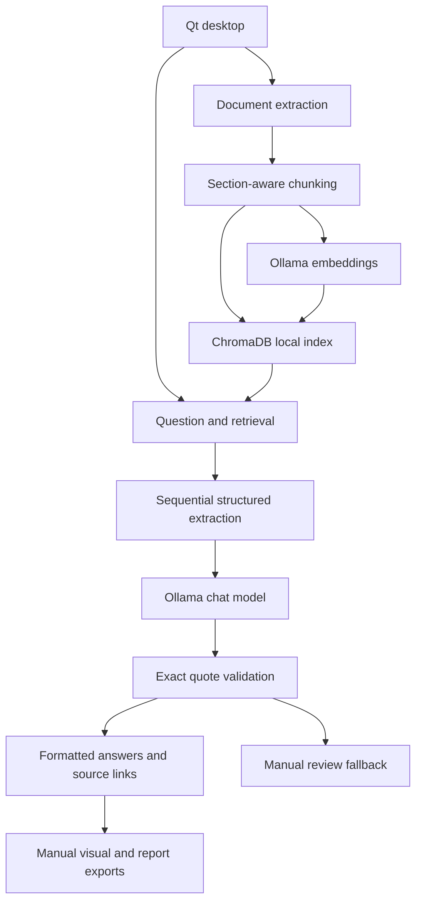

# Architecture

The default Ollama endpoint is http://127.0.0.1:11434. OLLAMA_URL overrides it; remote use changes the privacy boundary. Documents, database and exports live under the OS-specific DocMind data directory (LOCALAPPDATA on Windows). The 4.2 desktop path extracts quotes in small groups of three passages; malformed responses are retried and evidence may be shown for manual review. Quotation matching does not independently verify meaning, completeness or factual accuracy.

## Key modules
- desktop.py: Qt UI and background jobs.
- modules/document_processor.py, chunker.py: extraction and segmentation.
- modules/vector_store.py, embeddings.py, rag_engine.py: retrieval and orchestration.
- modules/structured.py, llm.py, presentation.py: structured inference, validation and rendering.
- modules/chat_manager.py, visuals.py, reports.py: history and exports.

## Trust boundaries
Uploaded documents are untrusted, even when local. Prompt instructions and quotation validation reduce but do not eliminate prompt injection. Keep the Ollama endpoint local, dependencies updated and data folder protected.
